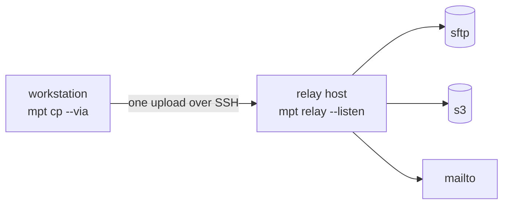
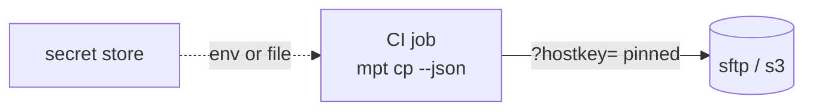
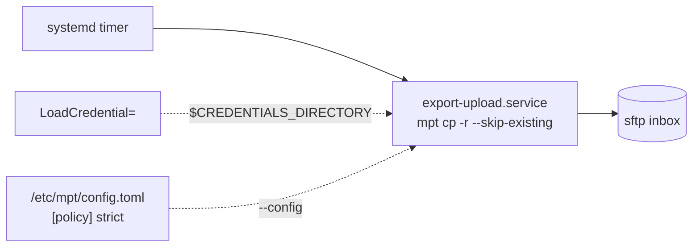
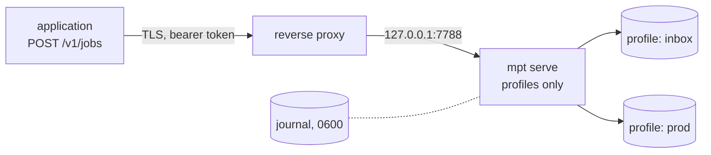
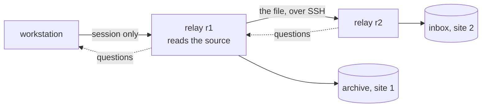
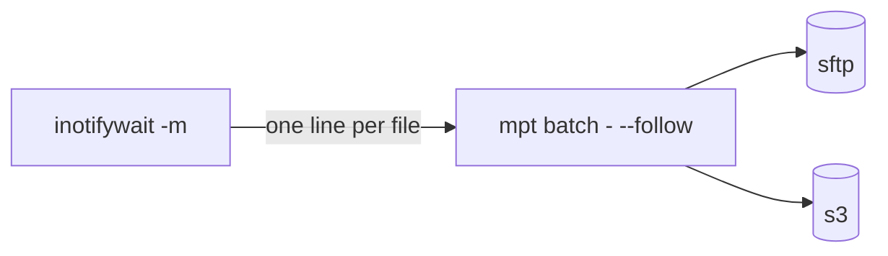

# Deployment patterns

Five arrangements that come up, each with where the pieces run, where the
configuration and the credentials live, and which page has the detail. They
combine: a CI runner may send through a relay, a server may name a relay in a
profile.

## A workstation and a relay

The everyday case for a thin uplink: the file leaves the workstation once,
and a well-connected host delivers it.



| Where | What lives there |
|---|---|
| workstation | the configuration with the profiles and their credential references; the SSH key that is in the relay's `authorized_keys`; the keys of SSH targets, offered through the forwarded agent |
| relay host | `mpt relay --listen`, its host key, `authorized_keys`; `--credentials on-demand` when no password should stay there |

[Relaying through a fast host](relay.md), [Running a relay](relay-host.md).

## A CI runner

A pipeline job has no maintained `known_hosts`, no agent, and secrets that
arrive as variables or mounted files. Pin the host key in the profile and read
the secret from where the platform put it.



```toml
[profiles.release]
url      = "sftp://deploy@srv.example.com/releases/"
hostkey  = "SHA256:GFb3ByRBzc3YOA2B7PCZeSWXCPpf4DIlKm/UrNkKGhY"
password = { env = "RELEASE_SFTP_PASSWORD" }
sign     = "ssh:${CI_PROJECT_DIR}/.keys/release_ed25519"
```

The job reads the exit code and keeps the JSON report as an artefact. `--json`
on stdout and the log on stderr keep the two apart in the runner's output.
[Pinning, for scripts and CI](../trust/connections.md#pinning-for-scripts-and-ci),
[Using mpt in scripts](../automation/scripting.md), [Signing](../trust/signatures.md#signing).

## A scheduled service account

A nightly export on a server, run by a timer, with the configuration where the
account cannot rewrite it and the secret delivered by systemd.



[Scheduled and triggered runs](../automation/scheduling.md#systemd),
[Where to put a policy](../configuration/policies.md#where-to-put-a-policy).

## A server behind a reverse proxy

Programs submit jobs over HTTP instead of spawning `mpt`. The server speaks
plain HTTP on loopback; a proxy adds TLS, and the profiles decide what a job
may reach.



The application follows a job over the WebSocket or polls it, and reads the
same report the command line prints. A journal makes a restart re-run what
was open. [Jobs over HTTP](serve.md), [Securing the
listener](serve.md#securing-the-listener), [HTTP API](../reference/api.md).

## Two sites, two relays

A source that sits behind one relay, a target behind another: the file goes
relay to relay, and the workstation only holds the session that carries the
questions and the report.



```toml
[profiles.incoming]
url = "/srv/incoming/report.pdf"
via = "mpt://r1"
[profiles.dc2]
url = "ftp://upload@dc2-store.example/in/"
via = "mpt://r2"
```

With `--via-credentials on-demand` neither relay keeps a password, and the
forwarded agent lets r1 log in to r2 without a key of its own. [Relay
topologies](relay-topologies.md), [Security overview](../security/overview.md).

## An event-driven queue

Work that arrives at unpredictable times: a watcher prints one line per file,
and `batch --follow` runs each line as it arrives.



Under systemd the watcher and `mpt` share one `Type=simple` service with
`Restart=always`, so both come back together. [Streaming input with
`--follow`](../guide/job-lists.md#streaming-input-with---follow),
[Event-triggered runs](../automation/scheduling.md#event-triggered-runs).
